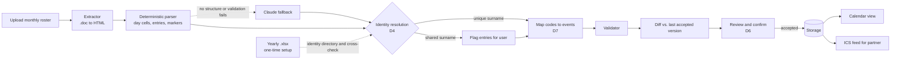

# Shift-Schedule App — Solution Architecture Document

> **Living document.** Puja and Claude are building this together as the architecture gets discussed and decided. Sections marked *TBD* fill in as the conversation progresses.
>
> **Revision note (2026-09-19):** this version keeps all original content and decisions (D1–D3) intact and adds items marked **Proposed** — they come from a review of this doc against the current repo (`scripts/send-roster-to-claude.mjs` and `sample-data/Hospital_ED_Roster_Sept2026_MOCK.docx`). Proposed items are not decisions until Puja accepts them. **Rev 3** re-grounds the design in the two real rosters now in `docs/` (yearly `.xlsx`, October 2026 monthly `.doc`), which differ materially from the mock. **Rev 4** records Puja's answers on codes and conventions and the tracked person (2026-09-20), and corrects Rev 3's claim that the monthly has no recoverable table. See [Appendix A](#appendix-a--what-changed-in-this-revision).

---

## 1. Overview

A household tool that parses shift-based work rosters (starting with a real hospital department roster) into structured, personal shift data, keeps a shared household calendar accurate as that roster changes, and — in a later phase — helps a dual-professional household divide chores and kid logistics based on real availability.

Built as a personal/portfolio project, and explicitly used as a hands-on solution architecture exercise: problem framing, requirements, architecture decisions, and build, done in sequence and documented like a real SA deliverable.

---

## 2. Business Problem

There is no existing consumer software that takes a real-world shift roster — especially a **shared, department-wide roster listing many employees, not a document already personalized to one person** — and automatically extracts one specific person's shifts from it, then keeps a household calendar in sync as revised versions come out.

Today that translation from "official roster document" to "what does this mean for my week" is done entirely by hand, repeated every time a new version is issued. This is meaningfully harder than "parse a shift schedule" — the source document isn't built for the person reading it, it's built for an entire department.

> **Concrete anchor case:** a hospitalist division issues two shared documents. The **yearly template** has one row per person (`Last, First`) and one coarse assignment per 4-week block. The **monthly on-call calendar** has one cell per *day* listing everyone working it — surname and a role code (`SURNAME-NT`), no first name. Nothing is personalized. Finding "my shifts" means scanning every day's cell for your name and knowing what the codes mean — the manual skill being replaced.

Broader applicability: the same pattern (shared department roster, rotating/irregular shifts, self-identification required) shows up for nurses, doctors, EMTs/paramedics, respiratory and radiology techs, first responders, corrections officers, airline pilots and flight attendants, transit/bus operators, manufacturing/plant shift workers, hospitality staff, and call-center/BPO workers on rotating coverage.

---

## 3. Target Users & Personas

**Primary niche:** dual-earner households where at least one partner works a rotating/shift-based schedule against a shared, not-personalized roster — not "any busy family."

- **The shift worker** — receives a shared roster they must self-locate within; needs their real shifts extracted reliably and automatically.
- **The planning partner** — needs visibility into the shift worker's real availability to coordinate household logistics, appointments, and (later) kid pickup/dropoff/activities.

**Phase 1 access model (decided, see D2):** single login (Puja). Her husband is a Phase 1 beneficiary of the *output* (the calendar) but not a logged-in actor yet — multi-user access, including his own roster uploads, is explicitly Phase 2+.

> **Open (see §10, Q3):** how does he actually *see* the calendar in Phase 1 if he has no login? Proposed answer: a read-only subscribable calendar feed (ICS).

---

## 4. Scope & Phasing

**Phase 1 (validate the hard part first):**

- Upload a roster (digital export or portal screenshot — see D1, D5)
- Claude-based parsing into structured shift data (date, shift type, start/end), specifically solving *identification within a shared multi-person document*
- **Proposed:** a review-and-confirm step before parsed data is committed (see D6)
- Store parsed shifts
- Basic calendar view
- Change detection when a revised roster version is uploaded — flag what changed rather than silently overwriting
- Single household, single-tenant. Built and tested against Puja's own household roster first.

**Phase 1 non-goals (Proposed):** multi-user auth, photographed/printed rosters (D1), chore/childcare logic, billing, mobile app, two-way calendar sync (write-back to Google/Apple).

**Phase 2 (future, not yet started):**

- Preferences/rules engine for chore and childcare assignment based on who's actually available
- Two-way availability matching between partners (e.g. "who's free for the kid's appointment next week")
- Conflict resolution logic when both partners are off, or both are on
- Manual override UI

---

## 5. Competitive Landscape

*Full write-up: see the companion doc `competitive-landscape-check.md` in the project.*

Summary: apps that turn an individual's *already-personal* shift schedule into a calendar already exist (NurseGrid, Shift2Cal, My Shift Planner, MYDUTY, Nurse Sync) — Shift2Cal specifically supports photo/screenshot scanning. None of the ones checked demonstrate extracting one person's shifts from a **shared, multi-employee department roster**, and none support **two-way household availability matching**. Those two remain the real, still-open gap — the original "nothing exists" framing was directionally right but needed narrowing to these two specifics.

---

## 6. Requirements

### Functional (Phase 1)

- [ ] Accept a digital roster upload (PDF, Word, or portal screenshot — see D5)
- [ ] Parse the roster and identify the correct individual within a multi-person document
- [ ] **Proposed:** when the user's name matches zero or more than one row, stop and ask the user — never guess (D4)
- [ ] Extract structured shift data: date, shift type, start time, end time
- [ ] **Proposed:** turn each entry into a calendar event — all-day by default (`T`, `NT`, `FMT`, `HOT`, `TR`, backup); timed only for the three admitting slots that print hours; a `*` adds a "late — stay until 7 PM" flag (D7)
- [ ] **Proposed:** show the extracted shifts to the user for confirmation before they are committed (D6)
- [ ] Persist parsed shifts
- [ ] Display shifts on a calendar view
- [ ] Detect and surface changes when a new roster version is uploaded (added/removed/edited shifts), rather than silently overwriting
- [ ] **Proposed:** give the planning partner read-only visibility of the calendar without a login (Q3)

### Non-Functional (Phase 1)

- Single-user/household scale — no multi-tenancy requirements yet
- Parsing accuracy is the primary quality bar — validated against Puja's real, real-world roster, not sample/demo data

**Proposed — filling in the former TBD:**

| Area | Proposed target |
| --- | --- |
| **Accuracy** | Measured on the *user's entries only*, day by day, against a hand-verified ground truth for at least 3 real roster months/versions. Track raw (pre-review) accuracy as the engine's score; the review step (D6) is what guarantees 100% before anything reaches the calendar. |
| **Latency** | A parse may take up to ~1–2 minutes; run it asynchronously with visible progress. No real-time requirement. |
| **Where parsing runs** | Server-side only. The Claude API key must never ship to the browser (D8). |
| **Retention & privacy** | A roster contains *other people's* names and schedules. Persist only the user's own rows; keep the original upload locally (git-ignored) for re-parse/audit and allow deleting it. Do not commit real rosters to the repo. |
| **Failure behavior** | Fail loudly: user not found, ambiguous match, unresolved times or role codes, missing days, or an entry contradicting the identity binding → surface an error and ask; never write a partial or guessed result to the calendar. |

---

## 7. Architecture

*Proposed — replaces the former TBD. Nothing here is decided until accepted.*

### 7.1 Component overview

| Component | Responsibility | Notes |
| --- | --- | --- |
| **Client** (React + Vite + Tailwind — already scaffolded, Upload and Calendar pages) | Upload, review/confirm screen, change-diff screen, calendar view | Talks only to the server; holds no secrets |
| **Server** (thin Node API) | Receives uploads, runs extraction, calls Claude, validates, resolves identity, computes diffs, serves the calendar | Only place the Anthropic key lives (D8). Small Node service; the SDK is already a dependency |
| **Extractor** | Turns an uploaded file into structured content: `.xlsx` read directly; legacy `.doc` converted to HTML, which keeps the calendar table and bold/underline/italic | Tiered by input type (D5). Text-only conversion loses both the table and the formatting |
| **Parser** | Deterministic: walks each day cell of the calendar table and reads its entries in order (code, `*`, attached time note, backup lines) | Both real rosters are structured enough that no model is needed for this format (D5) |
| **Claude call** (fallback) | Used only when a document has no recoverable structure (PDF/screenshot) or validation fails; JSON-schema constrained | Keeps the door open for other formats without making the model the critical path |
| **Validator** | Deterministic checks on the parser output | Every date in the roster's range appears exactly once; each day has the expected group sizes (4 `T`, 1 `FMT`, 9 `NT`, 1 `TR`, 3 admitting slots, 1 `*`); codes are in the code map; entries the yearly roster doesn't predict are surfaced as information, not errors |
| **Storage** | Profile, roster versions, the user's shifts, change sets | Phase 1: local SQLite — smallest footprint for a single user; revisit before Phase 2 multi-user |
| **Calendar feed** (optional, Q3) | Read-only ICS feed for the partner | Unguessable token URL; no login needed |

### 7.2 Data flow

### 7.3 Data model sketch (Phase 1)

- **profile** — full name (picked from the yearly roster), surname as printed in monthly rosters, home time zone, confirmed identity binding (D4)
- **code_map** — code → label and event type (all-day or timed). Seeded with the conventions Puja confirmed: `T` teaching, `NT` non-teaching, `FMT` family-medicine teaching, `HOT` hem-onc teaming (spelling to confirm), `TR` triage, `B/U` backup. Editable, because neither roster defines its codes
- **roster_version** — covered date range (parsed from content, not assumed to be a calendar month), revision text from the footer, original filename, upload timestamp, status (`pending_review` / `accepted` / `superseded`)
- **shift** — `roster_version_id`, date, `code`, `all_day`, `late` (from `*`), `start_at` / `end_at` only for timed admitting slots, `identity_confidence` (`bound` | `needs_confirmation`), raw source text
- **change_set** — between two versions: added / removed / edited shifts, each with before/after and a user disposition

### 7.4 Event semantics (Proposed, D7)

What the real October 2026 roster shows, and what Puja confirmed on 2026-09-20:

- **All-day by default.** `T`, `NT`, `FMT`, `HOT` and `TR` entries carry no hours and become all-day events.
- **Three admitting slots carry hours.** `(7A-7P)`, `(8A-8P)`, `(1P-12MN)` are printed on the line *below* the name they belong to, and are admitting shifts. Only these are timed (confirm: timed events, Q16). `12MN` means the end of that date.
- **`*` = the late person.** Exactly one `NT` per day is starred: that person must stay until 7 PM; other days they can leave early. Keep it as a flag on the entry and show it on the event, since the all-day event has no other way to say it.
- **Backup.** `B/U` lines are backup entries. Two lines per day, often blank.
- **Nights.** Night shifts should be labelled "Night". The October monthly contains no night entries at all; how they appear is open (Q15).
- **Ignore:** italics (no meaning) and the `AW` / `SD` / `SP` tags.
- **The roster period isn't a calendar month.** October runs 10/01 through 11/02. Parse the covered range from the content. All-day events also make DST largely irrelevant; it matters only for the timed admitting slots.
- **Still unresolved:** whether bold/underline mean anything (Q12) and what `***` marks (Q13).

### 7.5 Two roster types: yearly and monthly (Proposed)

Observed in the real files (2026–27 yearly template; October 2026 monthly):

| | **Yearly roster** | **Monthly roster** |
| --- | --- | --- |
| Format | `.xlsx`, one sheet: 14 four-week blocks across (e.g. `10/05–11/01`), one row per person, cell fills color-code assignment types | Legacy `.doc`, one page: a 7-column calendar table (Sun–Sat). Recoverable via HTML conversion, which keeps bold/underline/italic; plain-text conversion loses both |
| Names | `Last, First` in full | `SURNAME-ROLE`, caps, no first name; an initial is added only ad hoc (`T. SURNAME`) |
| Content | One coarse assignment per person per block (`NT 2,4`, `Admit 1,3`, `vaca/NT 3`, `backup`) — *which weeks* of the block, not which days | Who works each day and in what role; some slots carry explicit times |
| Role in the system | **Identity directory** + plausibility cross-check | **Shift source** — the document that's parsed and revised |
| Cadence | Once a year | Revised (footer text such as `REVISED: <date>`) |

How they fit together:

- **One-time setup:** upload the yearly roster, pick your full name; the app records your surname and whether it's shared with anyone else in the directory. Cheap, and it tells you up front how much of the D4 confirmation flow you'll actually see.
- **Unique surname:** match on surname, tolerating spelling variants (the monthly contains typos, and the surname also appears in slightly different forms elsewhere in the same document). Bind once after your confirmation.
- **Shared surname:** the monthly may print an initial on some days and the bare surname on others, so a bare entry is ambiguous by construction. Flag each ambiguous entry for confirmation.
- **Use the yearly as evidence, not as a decider.** Its block-level assignments can be checked against a monthly entry: if a bare `SURNAME-NT` falls in a week where only one of the two same-surname people has `NT` in that block, pre-select that person and show why. The user still confirms.
- **Crosswalk between the documents** (checked on block 5, 10/05–11/01): every untimed `-NT` name matches that person's yearly `NT` weeks (23 of 23); every one of the three admitting slots each week matches a yearly `Admit` assignment (12 of 12); the tracked person's `teach-O(1,3)` matches `T` on exactly weeks 1 and 3 (10/05–10/11, 10/19–10/25). Working mapping: `teach` ↔ `T`, `NT n` ↔ untimed `-NT`, `Admit n` ↔ the timed slots, `Triag` ↔ `TR`, `backup` ↔ `B/U`, `FMT` ↔ `FMT`, `HOT` ↔ `HOT`; `nights`, `vaca` and `xxx` have no monthly counterpart.
- **The two documents legitimately disagree.** The monthly is a revision of the plan. Example: the tracked person is on `T` for 10/03–10/04, which block 4 of the yearly doesn't predict; and the yearly assigns `HOT` in block 5 while this revision has none after 10/04 (filename `NO HOT`). Show such differences to the user as information.
- **Coverage is partial.** The yearly says which weeks, not which days, and its codes overlap only partly with the monthly's (`NT`, `FMT`, `HOT` appear in both; others don't). It is a plausibility check, not a second source of truth.

### 7.6 Change detection (Proposed)

- **Diff key:** (date, role code) for the user's entries, over the date range the two versions share. Compare the new extraction to the last *accepted* version covering those dates.
- **Change types:** added, removed, edited (code or times).
- **Version ordering:** use the roster's own revision text (footer `REVISED: …`) plus upload order, with a user override. Do **not** trust file metadata or the filename — in the October file, the saved-date metadata precedes the footer's revision date, and the filename says `FINAL`.
- **Past dates:** changes to dates already passed are shown but visually de-emphasized and default to "keep existing," since a revised roster usually shouldn't rewrite history.
- **Nothing overwrites silently:** accepting a change set is an explicit user action, and superseded versions are retained.

---

## 8. Key Decisions Log

| **ID** | **Decision** | **Rationale** | **Status** |
| --- | --- | --- | --- |
| D1 | Phase 1 targets a **digital roster source** (PDF export or portal screenshot), not a photo of a physical/printed document. | The core technical risk is already identifying one person inside a dense multi-person table. Photographing a physical document adds a second, independent risk (glare, angle, lighting affecting color-coding) on top of that. Isolate one hard variable at a time. Confirmed a digital version of the anchor roster actually exists. | Decided |
| D2 | Phase 1 is **single-user/single-login** (Puja only). Her husband can upload his own roster in a later phase once multi-user auth exists — not Phase 1. | Phase 1's goal is proving the parsing engine works, not proving multi-user auth. One fewer moving part while validating the hard part. | Decided |
| D3 | Future monetization direction (not Phase 1 scope): **flat subscription per household**, not metered pay-per-use. | Actual variable cost per household (AI parsing calls) is near-zero regardless of usage, so metering buys little margin protection but adds real billing complexity. More importantly, pay-per-parse would financially punish the exact behavior the product depends on — re-uploading a roster whenever it changes to catch revisions — directly undermining the core value proposition. Subscription also matches how comparable household-organization tools (Cozi Gold, TimeTree Premium) are already priced, so it fits buyer expectations. Likely shape: a free/limited tier (calendar viewing) plus a paid tier unlocking parsing and the Phase 2 duty engine, with a soft fair-use ceiling rather than true per-call metering to guard against extreme outlier abuse. | Directional |
| D4 | **Identity is user-confirmed, never inferred.** The profile stores the user's full name (picked from the yearly roster) and her surname as printed in monthly rosters. Unique surname → match with tolerance for spelling variants, confirmed once. Shared surname → every entry that doesn't carry a disambiguating initial is flagged for confirmation, pre-selected using yearly block assignments as evidence (§7.5). The app never silently picks. | The real monthly roster prints surnames only, with an initial added inconsistently (`T. SURNAME` on some days, bare surname on others). A shared surname is therefore ambiguous entry by entry, not just once. The earlier mock (two `Johnson, J.` rows) showed a milder version of the same problem. A wrong guess produces a confident, silently wrong calendar — the worst failure mode this product has. *Note (2026-09-20):* the tracked person's surname is unique in both rosters and the person isn't on nights this year, so the shared-surname branch is not exercised in Phase 1 (Q19). | Proposed |
| D5 | **Extraction is tiered by input type, deterministic first.** `.xlsx` (yearly) → read directly. Monthly `.doc` → converted to HTML, then parsed deterministically (day cells → entries), with validators on the result. Claude is a fallback for inputs with no recoverable structure (PDF/screenshot) or failed validation, not the Phase 1 critical path. Phase 1 commits to the two formats the real rosters arrive in, and asks the department for `.docx`/PDF only if conversion proves lossy. | Converting the real `.doc` to HTML yields a real calendar table with formatting intact, so the task is mechanical: walk the day cells and read entries in order. That is cheaper, repeatable, testable with exact-match tests, and it sends no coworker data to an external service, which also softens the employer-policy risk (§9). The remaining risks are semantic (what codes mean, what disagrees with the yearly), not extraction. Note D1 named PDF/screenshots; neither real source is one. **Changes the Phase 1 scope line "Claude-based parsing" — needs Puja's decision.** | Proposed |
| D6 | **Human review before commit.** Every parse (first upload and every revision) lands as `pending_review`; the user confirms the extracted shifts — or the change set — before anything reaches the calendar. | Accuracy is the stated primary quality bar; a review step is how to *guarantee* it while the model's raw accuracy is still being measured. The revision diff and the first-time confirmation can be the same screen. | Proposed |
| D7 | **Events are all-day by default; only the three admitting slots (which print hours) are timed; `*` becomes a "late — stay until 7 PM" flag; backup entries are typed; italics and `AW`/`SD`/`SP` are ignored.** Meanings live in an editable `code_map`. See §7.4. | Neither roster defines its codes, so the app must be told. Puja confirmed on 2026-09-20 that entries are all-day events, `*` marks the person who must stay until 7 PM, and italics carry no meaning. Timed treatment of admitting slots and how nights appear are still open (Q15, Q16). | Proposed |
| D8 | **All Claude calls go through a server**, never the browser. | The API key can't live in client code. The project is currently a browser-only Vite app plus a CLI script, so a thin server is the missing component. | Proposed |

---

## 9. Risks & Assumptions

- **Primary risk:** parsing reliability against a dense, multi-person document with implicit conventions (role codes, markers, time notes, inconsistent name forms) — the hardest and least-proven part of the whole system.
- **Assumption (confirmed for one month only):** the anchor roster's format and identification method is consistent month to month. Only the October 2026 monthly has been inspected; it uses `SURNAME-ROLE`, and the yearly uses `Last, First`.
- **Assumption (unconfirmed):** color-coding, if used as a parsing signal, survives faithfully in a portal screenshot/PDF export (vs. degrading the way it might in a photo).

**Proposed additions:**

- **Risk — the mock tests the wrong parser.** `Hospital_ED_Roster_Sept2026_MOCK.docx` is a person × date grid with a legend; the real monthly is a day-centric calendar with neither. Passing on the mock says little about the real thing. Build an *anonymized fixture that keeps the real structure* (same layout, invented names).
- **Risk — real rosters contain other people's data.** The files in `docs/` list dozens of coworkers by name and, in the monthly's footer, their personal pager/phone numbers. They must not be committed (add them to `.gitignore`), and the extraction step should ignore the contact-number block entirely. Persist only the user's own entries.
- **Risk — employer policy.** Sending a roster like this to an external AI service may not be allowed. With deterministic parsing (D5) nothing leaves the machine, which largely removes it; it returns only if the Claude fallback is used, and for any productized version (D3).
- **Risk — identity collision.** See D4: a surname shared by two people is ambiguous on every bare entry, and the document itself is inconsistent about printing initials. Also typos (the same surname spelled two ways within one document).
- **Risk — unlabeled conventions.** Neither file defines its codes. Puja confirmed most (§7.4); still unknown: bold/underline (Q12) and `***` (Q13). A wrong mapping produces a wrong calendar, so meanings live in an editable `code_map` and appear on the review screen.
- **Risk — legacy `.doc`.** No good Node reader; conversion to HTML works (e.g. `textutil` on macOS) but is an extra dependency and is not cross-platform (LibreOffice is the portable option). Mitigate by asking for `.docx`/PDF if it proves lossy and by validating day coverage after conversion.
- **Risk — unreliable version signals.** File metadata and filenames (`FINAL`) don't reliably order revisions; see §7.6.
- **Risk — accuracy testing.** Real files now exist, so accuracy *can* be measured — but ground truth for the user's entries must be hand-verified, and the real files stay out of git.
- **Assumption (unconfirmed):** the code meanings and the `*` rule are stable month to month.
- **Risk — documents legitimately disagree.** The monthly is a revision of the yearly plan, so mismatches are normal; the review screen must show them as information, never fail a parse on them.
- **Assumption (resolved):** color-coding exists in the yearly `.xlsx` (one fill per assignment type) but not in the monthly, which is black and white; the parser can't rely on color for the monthly.

---

## 10. Open Questions

1. ~~Data flow details end to end~~ — proposed in §7.2, pending review.
2. ~~Component boundaries (client / server / storage / AI parsing call)~~ — proposed in §7.1, pending review.
3. **How does the husband see the calendar in Phase 1 with no login (D2)?** Options: (a) read-only ICS subscription URL with an unguessable token — small, works in Google/Apple Calendar; (b) share screen/screenshot manually — not really a product; (c) pull multi-user forward — contradicts D2. Recommendation: (a).
4. ~~What file type does the real roster arrive in?~~ — resolved: yearly `.xlsx`, monthly legacy `.doc`. Can the department supply `.docx` or PDF instead?
5. **Local-only vs. hosted for Phase 1?** Recommendation: local (Vite + small Node server + SQLite) — smallest footprint and the roster stays on Puja's machine apart from the Claude call.
6. **Should changes to past dates be ignored by default?** Proposed yes (§7.6).
7. **Should backup (`B/U`) entries appear as an all-day "Backup" event?** Two lines per day, often blank.
8. ~~Does the yearly roster contain per-day shifts?~~ — resolved: no, block-level only (§7.5).
9. ~~What do the codes mean?~~ — mostly resolved (§7.4). Confirm the spelling of `HOT` (hem-onc teaming?).
10. ~~Whose shifts?~~ — resolved: one person with a unique surname who is not on nights this year (the yearly has `nights` only in block 2, already past).
11. **How do revisions actually arrive** (email attachment, shared drive), does each replace the whole month, and is the footer `REVISED:` text or the filename the reliable signal? *Not yet answered.*
12. **Do bold or underline mean anything?** They vary by day for the same person. *Not yet answered.*
13. **What does `***` (before 10/05 and 11/02) mark?** I think the first day of a new 4-week block. *Not yet answered.*
14. **Should the November roster win for the overlap dates (11/01–11/02)?**
15. **How should nights appear?** Puja said nights are labelled "Night", but the October monthly has none and the yearly gives only "nights" per block, with no days. Where do the night dates come from?
16. **Are the three admitting slots timed events (7A–7P etc.) or all-day with a note?**
17. **Why is the tracked person on `T` for 10/03–10/04** when the yearly doesn't predict it (weekend cover, a swap)? Tells us how often to expect unpredicted entries.
18. **Should vacation blocks from the yearly appear on the calendar?** The monthly never shows vacation.
19. **Phase 1 for shared surnames:** flag each ambiguous entry (D4 option A), or detect and stop with a clear message and defer the flagging UI? The tracked person's surname is unique, so it doesn't arise yet.

---

## 11. Roadmap

1. Architecture discussion (in progress) → this document
2. Phase 1 build: scaffold → parsing proof-of-concept on real roster → storage → calendar view → change detection
   - *Status:* scaffold done (React + Tailwind, Upload/Calendar nav). Parsing PoC started — `scripts/send-roster-to-claude.mjs` reads the mock `.docx` and calls Claude; its instructions are still a TODO. The mock does not match the real rosters' structure (§9).
   - **Proposed next steps within step 2:**
     1. Close the open questions (Q11–Q13, Q15–Q16) and decide D5 (deterministic parser vs. Claude) and D7. The real rosters are already git-ignored.
     2. Build an anonymized fixture with the real monthly's structure; keep the mock only as a secondary case
     3. Write the deterministic HTML parser for the calendar table; exact-match tests against the fixture, then privately against the real file
     4. Build the validator (§7.1), the `code_map` config, and a small hand-verified ground-truth set for the tracked person
     5. Add the server and storage; review/confirm screen → calendar view
     6. Revision upload → change-set diff
     7. (Optional) ICS feed for the partner
3. Validate Phase 1 against real, ongoing use in Puja's household
4. Phase 2: duty/availability engine

---

## Appendix A — What changed in this revision

| Where | Change |
| --- | --- |
| §3, §10 | Flagged the inconsistency between "husband benefits from the calendar" and "no login" (Q3) |
| §4 | Added Phase 1 non-goals and the review step |
| §6 | Added requirements for ambiguous identity, time resolution, review, partner visibility; filled the NFR TBD with proposed targets |
| §7 | New (was TBD): components, data flow diagram, data model, time semantics, change detection |
| §8 | Added D4–D8 as **Proposed**; D1–D3 unchanged |
| §9 | Added identity-collision, untestable-accuracy, third-party-data, silent-revision risks and two assumptions |
| §10–11 | Struck through resolved-in-draft questions, added new ones, updated roadmap with current repo status |
| **Rev 4** (Puja's answers, 2026-09-20) | Tracked person identified (unique surname, not on nights this year); code meanings confirmed (`T` teaching, `NT` non-teaching, `FMT`, `HOT`, `TR`, `B/U`); entries are all-day events; `*` = late person (stay until 7 PM); italics and `AW`/`SD`/`SP` ignored |
| §7.1–7.2, D5 | Corrected: the monthly *is* a table (HTML conversion recovers it with formatting), so parsing becomes deterministic and Claude a fallback. **New decision for Puja** |
| §7.3–7.4, D7 | `role_map`/times replaced by `code_map`, all-day events, `late` flag; admitting slots the only timed entries |
| §7.5 | Added yearly↔monthly crosswalk with evidence (23/23 NT, 12/12 Admit, `teach-O(1,3)` = T weeks 1 and 3) and the note that the documents legitimately disagree |
| §9–10 | Employer-policy risk softened by D5; colour assumption resolved; new open questions Q11–Q19 (revisions, bold/underline, `***`, nights, timed admits, unexplained T days, vacation, shared-surname scope) |
| §2, §9, D4, new §7.5 | Second pass: yearly = identity directory, monthly = shift source |
| **Rev 3** (real rosters) | The two real files replaced several assumptions: the monthly is a day-centric calendar (not person × date), surname-only with role codes, has no legend, is a legacy `.doc`; the yearly is a block-level `.xlsx` |
| §2, §6 | Anchor case rewritten from the real documents |
| §7.1–7.4 | Extractor/Claude call/validator, flow diagram, data model (`role_map`, `time_source`, `identity_confidence`), and time semantics rewritten (implicit times, non-month periods, DST on 11/01) |
| §7.5 | Rewritten with observed formats; the yearly is a plausibility check, not a decider; row-order option dropped (the monthly has no rows) |
| §7.6 | Diff key now (date, role code); version ordering from footer text, not file metadata |
| D4, D5, D7 | Revised to match the real documents |
| §9 | Mock-vs-real mismatch, coworker PII and phone numbers, unlabeled conventions, `.doc` conversion, version signals added; resolved assumptions removed |
| §10–11 | Q4 and Q8 resolved; Q9–Q11 replace the old Q9–Q10; roadmap reordered around a real-structure fixture |
